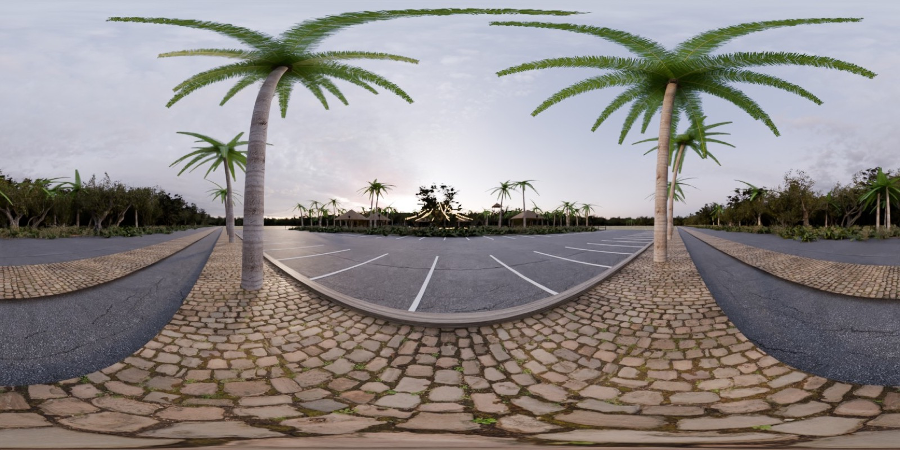
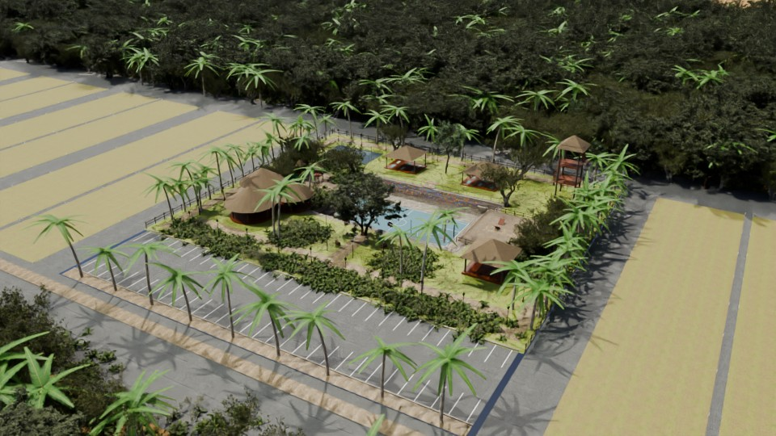

# Tour 360° fotorrealista con Blender (sin abrir Blender)

Genera desde código un parque tropical completo en **Blender + Cycles**, lo renderiza como **panoramas 360° equirectangulares** y fotos fijas, y arma un **visor web** donde se recorre arrastrando y saltando entre puntos.

Todo se hace desde la terminal con scripts de Python: no hay que modelar nada a mano. La escena sale de un plano de lotes (`data/lotes.json`), y los árboles, texturas y cielos son assets gratuitos CC0 de [Poly Haven](https://polyhaven.com).




> Las imágenes de arriba salieron de este repo tal cual, con el plano de ejemplo y en calidad de prueba (1536 px, 16 muestras, 41 s).

## Qué obtienes
- **9 panoramas 360°** al atardecer (llegada, ceiba, cancha, dentro de la cancha, yoga, mirador, juegos, palapas y dron a 55 m), a 3072 × 1536 px.
- **12 fotos fijas** de 1920 × 1080 (6 tomas × atardecer y día).
- **Visor web** (`web/dist/tour/index.html`) con three.js: arrastrar para mirar, puntos para saltar, minimapa con orientación y galería de fotos.
- Opcional: el archivo `.blend` para abrirlo y seguir editando en Blender.

## Equipo donde se probó

| | Probado |
|---|---|
| Equipo | **Mac mini M4** (Mac16,10): CPU de 10 núcleos (4 de rendimiento y 6 de eficiencia), GPU de 10 núcleos, Metal 4 |
| Memoria | 16 GB de memoria unificada (pico medido: **~6 GB**) |
| Sistema | macOS 26.6 |
| Blender | **5.3.0** (Cycles en GPU con Metal, denoiser OpenImageDenoise, color AgX) |
| Python | 3.9 o superior (el de macOS sirve), con Pillow |
| Disco | ~2 GB libres: 900 MB de assets, ~20 MB de renders y 600 MB si guardas el `.blend` |
| Internet | Solo para la descarga inicial de assets (~900 MB) y para que el visor cargue three.js |
| Tiempo | Render completo: **~11 min** en el M4. Prueba rápida: ~1 min |

Requisitos mínimos, otras máquinas (Windows, Linux, Intel) y tiempos esperados: [docs/REQUISITOS.md](docs/REQUISITOS.md).

## Inicio rápido (macOS)

```bash
# 1. Herramientas (una sola vez)
xcode-select --install            # si no tienes las herramientas de línea de comandos
brew install --cask blender       # o descárgalo de blender.org (versión 4.2 o más nueva)

# 2. Clonar y correr todo
git clone https://github.com/erlinares/claude_blender_360.git
cd claude_blender_360
./run_all.sh

# 3. Ver el tour
.venv/bin/python -m http.server -d web/dist/tour 8000
# abre http://localhost:8000
```

`run_all.sh` hace, en orden:
1. Crea `.venv` e instala Pillow.
2. Descarga de Poly Haven los modelos, texturas y cielos HDRI (`tools/blender/fetch_assets.py`).
3. Genera la duela de básquetbol y la fronda de palma (`tools/blender/make_textures.py`).
4. Crea un plano de lotes de ejemplo si no tienes uno (`tools/make_sample_lots.py`).
5. Construye la escena y renderiza panoramas y fotos con Blender en segundo plano (`tools/blender/render_all.sh`).
6. Arma el visor web (`tools/build_tour.py`).

El paso a paso con cada comando y lo que debe salir en pantalla está en [docs/PASO_A_PASO.md](docs/PASO_A_PASO.md).

## Estructura

```
run_all.sh                     todo de punta a punta
requirements.txt               Pillow
data/lotes.json                plano de lotes (ejemplo incluido; cámbialo por el tuyo)
tools/make_sample_lots.py      genera un plano de lotes de ejemplo
tools/blender/fetch_assets.py  descarga assets CC0 de Poly Haven -> assets/polyhaven/
tools/blender/make_textures.py texturas propias -> assets/blender/
tools/blender/build_park.py    escena completa en Blender (se ejecuta DENTRO de Blender)
tools/blender/render_all.sh    render final (panoramas + fotos)
tools/build_tour.py            visor web -> web/dist/tour/
web/src/tour360.template.html  plantilla del visor (three.js r128)
docs/                          requisitos, paso a paso, cómo funciona, personalizar, problemas
.claude/agents/                agente para escribir el guion del video tutorial
```

## Documentación
- [Requisitos y rendimiento](docs/REQUISITOS.md)
- [Paso a paso](docs/PASO_A_PASO.md)
- [Cómo funciona por dentro](docs/COMO_FUNCIONA.md)
- [Personalizar: tu plano, tus cámaras, tu luz](docs/PERSONALIZAR.md)
- [Solución de problemas](docs/PROBLEMAS.md)

## Licencias
- Código: MIT ([LICENSE](LICENSE)).
- Assets de Poly Haven: CC0, no vienen en el repo y se descargan con el script ([CREDITS.md](CREDITS.md)).
- Los renders son **ilustrativos**. Si los usas para vender un proyecto real, indícalo en la pieza.
